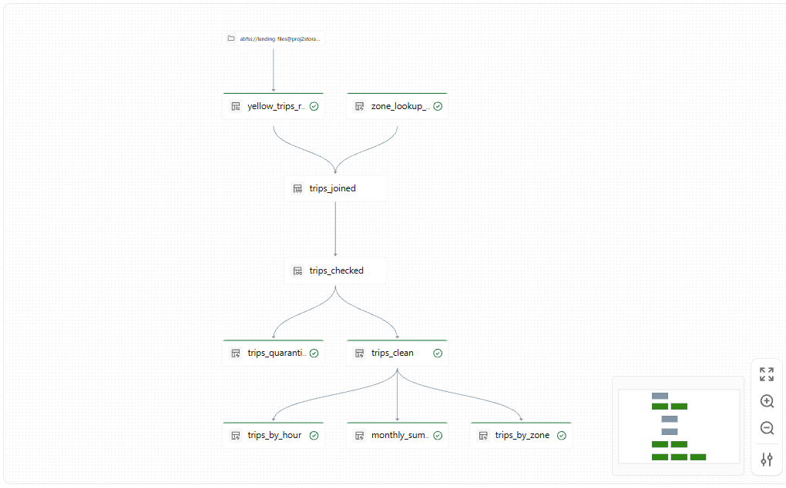
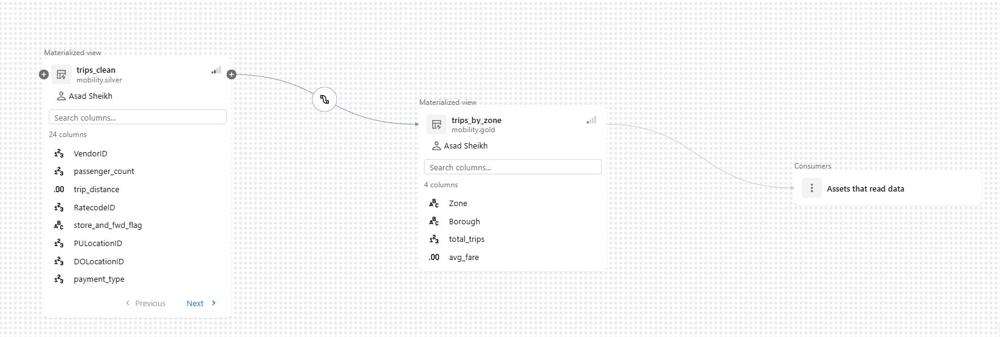
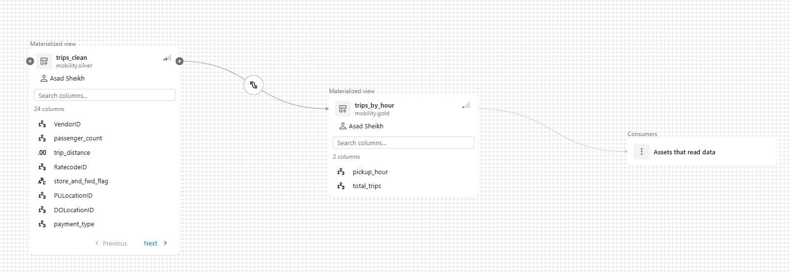
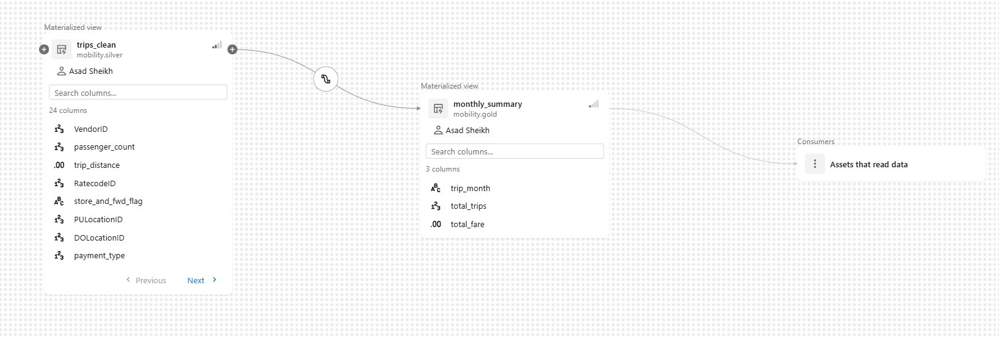

# 🚕 Urban Mobility Lakehouse – NYC Yellow Taxi on Azure Databricks

_Turning raw monthly taxi trip files into clean, governed tables and a dashboard, using a Bronze / Silver / Gold lakehouse built with Lakeflow Declarative Pipelines in PySpark._

---

## 📌 Table of Contents
- <a href="#overview">Overview</a>
- <a href="#business-problem">Business Problem</a>
- <a href="#dataset">Dataset</a>
- <a href="#tools--technologies">Tools & Technologies</a>
- <a href="#project-structure">Project Structure</a>
- <a href="#data-cleaning--preparation">Data Cleaning & Preparation</a>
- <a href="#data-quality-analysis">Data Quality Analysis</a>
- <a href="#results--key-findings">Results & Key Findings</a>
- <a href="#dashboard">Dashboard</a>
- <a href="#governance--lineage">Governance & Lineage</a>
- <a href="#how-to-run-this-project">How to Run This Project</a>
- <a href="#next-steps">Next Steps</a>
- <a href="#author--contact">Author & Contact</a>

---
<h2><a class="anchor" id="overview"></a>Overview</h2>

This project builds a lakehouse for NYC yellow taxi trips (January to March 2024, 9,554,778 trips). Raw files are kept as they arrive, improved through explicit Bronze, Silver and Gold layers, and served through a dashboard. Rows that fail a quality rule are not deleted: they go to a quarantine table with a reason, and every source row is reconciled to an accepted or quarantined outcome.

```
TLC Parquet files + zone lookup CSV   (downloaded and uploaded by hand)
        |
        v
ADLS Gen2   (container: landing-files)
        |
        v
Lakeflow Declarative Pipeline (PySpark, Azure Databricks)
   Bronze  raw Delta tables, loaded incrementally with Auto Loader
   Silver  zone join, type fixes, quality rules -> clean + quarantine tables
   Gold    trips by zone, trips by hour, monthly summary
        |
        v
Databricks SQL warehouse  ->  Dashboard

Unity Catalog: catalog "mobility" (bronze / silver / gold), read-only grants on Gold, lineage
```

---
<h2><a class="anchor" id="business-problem"></a>Business Problem</h2>

A mobility operations team receives large monthly taxi trip files. Invalid journeys, negative fares and location IDs that mean nothing on their own make its reports unreliable. This project aims to:
- Keep the source data untouched and improve it layer by layer
- Replace location IDs with zone and borough names
- Quarantine impossible or suspicious trips with a clear reason instead of hiding them
- Show demand by zone, by hour of day and by month
- Prove that no row is lost or loaded twice

---
<h2><a class="anchor" id="dataset"></a>Dataset</h2>

- [NYC TLC trip records](https://www.nyc.gov/site/tlc/about/tlc-trip-record-data.page): yellow taxi Parquet files for January, February and March 2024
- [Taxi zone lookup CSV](https://d37ci6vzurychx.cloudfront.net/misc/taxi_zone_lookup.csv): 265 zones with borough and service zone (included in `data/`)
- [Yellow taxi data dictionary](https://www.nyc.gov/assets/tlc/downloads/pdf/data_dictionary_trip_records_yellow.pdf)

| File                              | Rows      |
|-----------------------------------|-----------|
| `yellow_tripdata_2024-01.parquet` | 2,964,624 |
| `yellow_tripdata_2024-02.parquet` | 3,007,526 |
| `yellow_tripdata_2024-03.parquet` | 3,582,628 |
| **Total**                         | 9,554,778 |

These are historical monthly releases, not a live feed. The Parquet files are 49 to 59 MB each, so they are not stored in this repository; see `data/README.md` for the download links.

---
<h2><a class="anchor" id="tools--technologies"></a>Tools & Technologies</h2>

- Azure Databricks: Lakeflow Declarative Pipelines (Spark Declarative Pipelines), PySpark, Auto Loader, Delta Lake
- Azure Data Lake Storage Gen2 (landing files)
- Unity Catalog (catalog, schemas, permissions, lineage)
- Databricks SQL warehouse and Databricks dashboards
- GitHub

---
<h2><a class="anchor" id="project-structure"></a>Project Structure</h2>

```
urban-mobility-lakehouse/
│
├── README.md

│
├── data/                          # reference data and download links
│   ├── README.md
│   └── taxi_zone_lookup.csv
│
├── notebook-pipeline/             # pipeline code and checks
│   ├── bronze.py
│   ├── silver.py
│   ├── Gold.py
│   └── CHECK.ipynb
│
├── dashboard/                     # exported Databricks dashboard
│   └── mobility_dashboard.lvdash.json
│
├── dashboard_queries/             # SQL behind the dashboard charts
│   └── mobility_dashboard_queries.sql
│
└── screenshots/
    ├── dashboard.png
    ├── pipeline_graph.png
    ├── lineage_trips_by_zone.png
    ├── lineage_trips_by_hour.png
    └── lineage_monthly_summary.png
```

---
<h2><a class="anchor" id="data-cleaning--preparation"></a>Data Cleaning & Preparation</h2>

| Layer  | Tables                                                                      | What happens                                                            |
|--------|-----------------------------------------------------------------------------|-------------------------------------------------------------------------|
| Bronze | `yellow_trips_raw` (streaming table), `zone_lookup_raw` (materialized view) | Source data as it arrived. Auto Loader reads only new files, so adding a|
|        |                                                                             | month does not reload earlier ones.                                     |
|        |                                                                             |                                                                         |
| Silver | `trips_clean`, `trips_quarantine`                                           | Pickup zone joined, `timestamp_ntz` converted to `timestamp`, every row |
|        |                                                                             | checked against the rules below.                                        |
|        |                                                                             |                                                                         |
| Gold   | `trips_by_zone`, `trips_by_hour`, `monthly_summary`                         | Aggregates built from `trips_clean`.                                    |


---
**Quality rules.** Rules run in order and the first match wins. A row that matches none goes to `trips_clean`; every other row goes to `trips_quarantine` with its reason.

| Order | Reason                     | Condition                                       |
|-------|----------------------------|-------------------------------------------------|
| 1     | `MISSING_TIMESTAMP`        | pickup time is empty                            |
| 2     | `DATE_OUT_OF_RANGE`        | pickup time outside 2024-01-01 to 2024-03-31    |
| 3     | `INVALID_PICKUP_ZONE`      | pickup location ID not found in the zone lookup |
| 4     | `DROPOFF_NOT_AFTER_PICKUP` | drop-off time is not after pickup time          |
| 5     | `NEGATIVE_FARE`            | fare_amount below zero                          |

Other preparation steps: 
- Pickup and drop-off times arrive as `timestamp_ntz`, which Delta needs switched on as a table feature (`delta.feature.timestampNtz`); Silver converts them to regular timestamps.
- A left join keeps every trip even when no zone matches, so no row disappears silently.
- Auto Loader adds a `_rescued_data` column that collects data not matching the expected schema.

---
<h2><a class="anchor" id="data-quality-analysis"></a>Data Quality Analysis</h2>

Rejected rows across the three months (139,377 of 9,554,778, or 1.46%):

| Reason                     | Rows    |
|----------------------------|---------|
| `NEGATIVE_FARE`            | 136,555 |
| `DROPOFF_NOT_AFTER_PICKUP` | 2,801   |
| `DATE_OUT_OF_RANGE`        | 21      |
| `MISSING_TIMESTAMP`        | 0       |
| `INVALID_PICKUP_ZONE`      | 0       |

**Negative fares (1.43% of all rows):** by payment type, 51% are disputes (type 4, 69,950 rows), 20% cash (27,231), 15% Flex Fare (21,022), 13% no charge (18,266) and under 0.1% credit card (86). Payment type labels are from the TLC data dictionary. These look like adjustments and reversals rather than corrupt records, so they are held out of the fare totals and kept for review.

**Impossible journeys:** 2,801 trips end at or before their pickup time.

**Dates outside the period:** 21 trips have pickup dates far from the file's month (the January run showed 2002, 2009 and 2023 dates). They are quarantined instead of creating stray months in the reports.

**Clean joins:** no pickup location ID was missing from the lookup, so the zone join found a match for every trip.

---
<h2><a class="anchor" id="results--key-findings"></a>Results & Key Findings</h2>

**Reconciliation (`notebook-pipeline/CHECK.ipynb`)**

| Check                          | Result                                               |
|--------------------------------|------------------------------------------------------|
| Rows in the three source files | 9,554,778                                            |
| Rows in Bronze                 | 9,554,778 (same as the source, no file loaded twice) |
| Silver clean rows              | 9,415,401                                            |
| Silver quarantined rows        | 139,377                                              |
| Clean + quarantined = Bronze   | True                                                 |

**Findings**
1. **Demand is concentrated in Manhattan and the airports.** The top 10 pickup zones are mostly Manhattan zones (Midtown Center, Midtown East, Times Sq/Theatre District, Penn Station, Upper East Side North and South, Upper West Side South, Lincoln Square East), plus JFK Airport and LaGuardia Airport.
2. **Airport trips are far more expensive.** In the January run, the average base fare was $62.47 from JFK and $42.29 from LaGuardia, against roughly $12 to $18 for the Manhattan zones in the top 10.
3. **Demand follows the day.** Trips are lowest around 4 am and peak around 6 pm.
4. **Trips grow through the quarter.** Clean trips by pickup month: 2,926,303 in January, 2,966,077 in February and 3,523,021 in March.

---
<h2><a class="anchor" id="dashboard"></a>Dashboard</h2>

The dashboard `NYC Taxi Mobility Dashboard` has four charts:
- **Top zones:** the 10 busiest pickup zones
- **Hourly demand:** trips by hour of day
- **Monthly totals:** trips per month, January to March 2024
- **Rejected records:** quarantined rows by reason

The first three read the Gold tables; Rejected records reads the quarantine table. The queries are in `dashboard_queries/mobility_dashboard_queries.sql` and the exported dashboard is in `dashboard/`.

Fare note: `fare_amount` is the base metered fare only. It excludes tips, tolls and extras.


**Pipeline graph**



---
<h2><a class="anchor" id="governance--lineage"></a>Governance & Lineage</h2>

- The catalog `mobility` has three schemas: `bronze`, `silver` and `gold`.
- All account users have `USE CATALOG` on the catalog and `USE SCHEMA` plus `SELECT` on `gold` only. Bronze and Silver are not granted, so they stay private.
- The storage account is registered in Unity Catalog with a storage credential (an access connector with a managed identity) and an external location for the `landing-files` container.
- Lineage is captured automatically from `trips_clean` to each Gold table:





---
<h2><a class="anchor" id="how-to-run-this-project"></a>How to Run This Project</h2>

1. Create an ADLS Gen2 storage account with a container named `landing-files`, an access connector with the Storage Blob Data Contributor role on it, and an Azure Databricks workspace (Premium) attached to a Unity Catalog metastore.
2. In Databricks, create a storage credential from the access connector and an external location for the container.
3. Create the catalog `mobility` and the schemas `bronze`, `silver` and `gold`.
4. Download the three monthly Parquet files (links in `data/README.md`) into `landing-files/yellow_taxi/`, and upload `data/taxi_zone_lookup.csv` into `landing-files/reference/`.
5. Create an ETL pipeline with default catalog `mobility` and add `bronze.py`, `silver.py` and `Gold.py` from `notebook-pipeline/`. Update the storage account name in `bronze.py` to match yours.
6. Click **Run pipeline**.
7. Open `notebook-pipeline/CHECK.ipynb` to run the reconciliation checks.
8. Create a SQL warehouse, then import `dashboard/mobility_dashboard.lvdash.json`, or build the charts from `dashboard_queries/mobility_dashboard_queries.sql`.

---
<h2><a class="anchor" id="next-steps"></a>Next Steps</h2>

**Next steps**
- Run and document the recovery tests
- Join the drop-off zone and add trip duration and distance metrics
- Add a file manifest, a schedule and failure alerts
- Extend the data to 12 months

---
<h2><a class="anchor" id="author--contact"></a>Author & Contact</h2>

**Asad Sheikh**  
📧 Email: masad03sheikh@gmail.com 
🔗 LinkedIn: www.linkedin.com/in/madasad-sheikh
